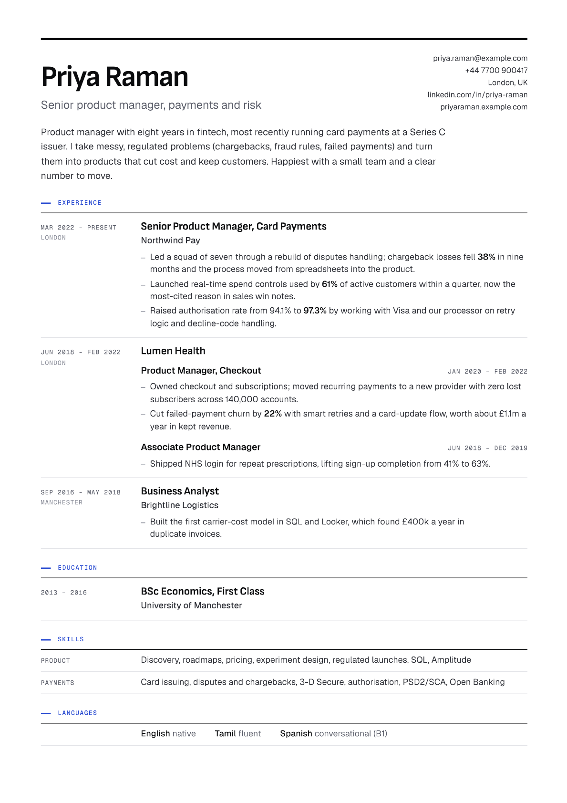

# Job desk

A job-hunt assistant that runs in Claude (or Codex) on your own computer. It does the admin of a job search so you can apply faster: it finds jobs, helps you pick, gets your CV right for each one, fills in the applications, follows up on every one, finds the recruiter on LinkedIn when there's nobody to email, reads your inbox for replies and interviews, and keeps a record of everything.

You stay in charge. For the first couple of emails of each kind, it asks what you'd say and tidies it up, so they sound like you. Then it drafts and you check. Once you've approved five of a kind without changes, it sends those itself and still shows you one now and then. Applications always wait for your go.

## How it works

Every job goes round the same loop:

1. **Find** jobs: company job boards, job sites, LinkedIn and other boards in your browser.
2. **Pick** the ones worth applying for. It scores each against what you want; you choose.
3. **The CV:** for each job, does your main CV work as it is, or does it need tailoring? It does the tailoring.
4. **Apply:** it fills in the form and shows you everything before it goes.
5. **Follow up:** it keeps an eye on every application, chases when it's time, and pushes politely when things stall.
6. **Record** every step, so you can ask "where am I with Monzo?" or "how's it going?" any time.

Along the way it gives you honest advice: how many applications to send, where to aim, and what's working.

## Get started

About 30 minutes, most of it talking about your CV and what you're looking for. You need a Mac or Windows computer and a paid Claude plan (Pro or Max).

### 1. Install Claude for desktop

Download it from [claude.ai/download](https://claude.ai/download), install it, open it and sign in.

### 2. Install Google Chrome and the Claude extension

1. If you don't have it, install [Google Chrome](https://www.google.com/chrome).
2. In Chrome, open the Chrome Web Store, search for **Claude**, and add the extension by Anthropic ("Claude in Chrome").
3. Click the extension's icon in Chrome's toolbar (pin it from the puzzle-piece menu) and sign in with the same Claude account.
4. Sign in to LinkedIn and Gmail in that Chrome, if you aren't already.

This lets the assistant read job boards and LinkedIn as you, and fill in application forms. It always stops for your go before submitting anything.

### 3. Connect Gmail

In the Claude desktop app: **Settings › Connectors**, find **Gmail**, click **Connect**, and sign in with the Google account you use for your job search. Allow it to read and send.

This lets it read replies from employers and send the follow-ups and replies you've approved.

### 4. Install Node.js

Download the **LTS** version from [nodejs.org](https://nodejs.org) and install it with the default options. (It runs the tools that print your CV and keep your records. You won't need to touch it.)

### 5. Start the assistant

1. Make an empty folder, for example `Documents/job-search`.
2. In the Claude desktop app, open the **Code** tab and choose that folder.
3. Paste this and press Enter:

   > Set up my job desk: clone https://github.com/dougwithseismic/job-desk into this folder, then read SETUP.md and go through it with me step by step.

4. When it asks for your CV, drag the file into the chat. No CV? It'll build one with you.

It installs everything, tests Gmail and Chrome, reads your CV and turns it into a clean PDF, asks what you're looking for, agrees a plan with you, and asks your permission to send emails, LinkedIn messages and applications for you.

If Claude asks for permission to run a command or use a tool, that's normal: allow it.

## Using it

Every day, or every couple of hours while you're job hunting, open the folder in the Code tab and type **/job-desk**. It picks up where it left off, tells you what's happened since last time (replies, what's due, what's waiting for you), suggests what to focus on, and asks what you'd like. Then just talk to it:

- **"Find me jobs"**: searches and shows you the best matches, with the reasons and whether your main CV works for each.
- **"Apply to 2 and 5"**: gets the CV right, fills in the forms, shows you everything, and submits when you say go.
- **"Run a round"**: checks your email, sends the follow-ups that are due, finds new jobs and gets applications ready.
- **"What's waiting?"**: anything that needs you.
- **"Check my email"**: logs confirmations, rejections and interview invites, and helps you reply.
- **"Prep me for the Monzo interview"**: a prep pack and a practice run.
- **"How's it going?"** or **"what should I do?"**: where everything stands, and its honest advice.
- **"Export"**: a spreadsheet of every job and where it stands.

## Your data

Everything (your CV, the jobs, every email and decision) lives in the `data/` folder on your computer. It's never uploaded or shared, and never part of the code. To get updates, say "update the job desk".

## Troubleshooting

- **"Check my setup"** runs a check and fixes what it can.
- **It can't see Gmail:** check Settings › Connectors in the Claude app shows Gmail as connected, then start a new chat.
- **It can't use Chrome:** make sure Chrome is open and the Claude extension is signed in, then start a new chat.

## What's inside

| Path | What |
| --- | --- |
| `AGENTS.md`, `CLAUDE.md`, `SETUP.md` | Instructions for the agent |
| `.claude/skills/` (also `.agents/skills/`) | The skills: `job-desk` (the daily work), `cv` (CVs and letters), `setup` |
| `db/schema.sql` | The desk's SQLite tables |
| `bin/db.mjs` | Reads and writes the desk; `export` makes a CSV |
| `bin/jobs.mjs` | Pulls jobs from Greenhouse, Lever, Ashby, Workable, SmartRecruiters, Recruitee, Personio, Teamtailor, Remote OK, Himalayas, Jobicy, Arbeitnow, Hacker News "Who is hiring", Adzuna and Reed |
| `bin/cv.mjs` | Renders CVs and letters to PDF with your Chrome, and checks what an ATS reads |
| `templates/cv/` | The CV and letter design |
| `assets/fonts/` | Sofia Sans, Geist and Geist Mono (SIL Open Font License) |
